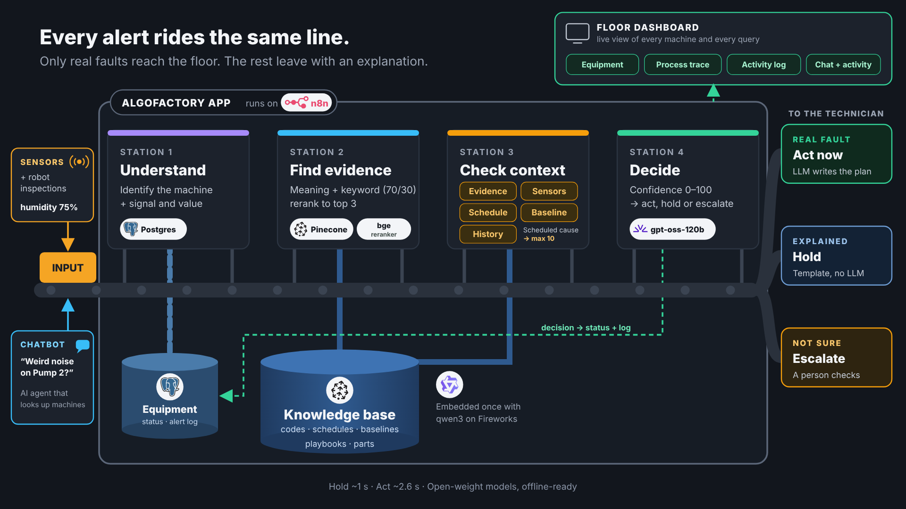
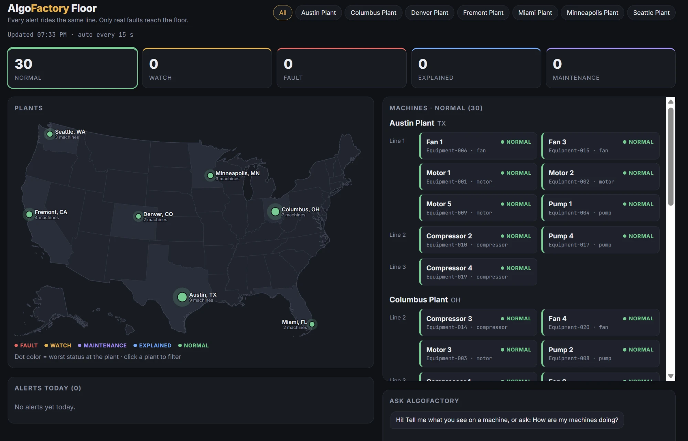

# AlgoFactory

**Context-aware equipment anomaly detection: less chasing, more fixing.**

Built in n8n for the Maven *Mastering Agentic AI* course, Week 2: Grounding AI with RAG.

| | |
|---|---|
| 🎥 **Demo video** | [Watch on Loom](https://www.loom.com/share/848d4e7be716474ebb86c4bddc2246cd) |
| 📄 **Project documentation** | [Google Doc](https://docs.google.com/document/d/1gyhR8FPh2CzAEio0qKukoo1eWDeElIg-aBoy9viCb0o/edit) |
| 📊 **Executive deck** | [AlgoFactory-deck.pdf](AlgoFactory-deck.pdf) |

## The problem

A maintenance technician gets dozens of sensor alerts a shift, and a large share are false. Many have an innocent reason: a scheduled wet-wash, normal operating conditions, or a known pattern. A sensor sees the reading but not that context, so each alert means a walk out to the machine to check.

AlgoFactory checks the context first. Alerts with an innocent explanation are held with a reason, and only real faults reach the technician.

## Architecture

Sensor alerts and worker chat questions both enter the same four-station line:

| Station | What happens | AI or rules |
|---|---|---|
| **1. Understand** | Identify the machine and the reading. In chat, an AI agent interprets the question and calls a Postgres lookup tool. | AI agent + SQL |
| **2. Find evidence** | Hybrid retrieval over maintenance playbooks: dense search (`qwen3-embedding-8b`, Pinecone, top 20) plus BM25 keyword search (top 10), merged 0.7 / 0.3 and reranked (`bge-reranker-v2-m3`) to the best 3. | AI retrieval |
| **3. Check context** | Score five layers: Evidence (0–50), Sensors (0–40), Schedule (−40 to +5), Baseline (−25 to 0), History (−5 to 0). A scheduled cause caps the score at 10; with no evidence the maximum is 45. | Rules (auditable) |
| **4. Decide** | **≥ 60 → Act now:** `gpt-oss-120b` writes an action plan from the 3 retrieved documents only, with citations. **Hold:** template explanation, no LLM call. **Escalate:** needs a human. | Rules decide, LLM writes |

> **AI understands, finds and writes. Rules decide.**

Each decision updates the machine's status (Act → Fault, Escalate → Watch, Hold → Explained, which returns to Normal after 3 hours) and the alert log, which drive the floor dashboard.

**Example:** 75% humidity on Motor 1 right after a scheduled wet-wash is held as *Explained* in about a second, with no LLM call and no alarm.

## Floor dashboard

Served by n8n at `/webhook/floor`. It shows status counts, 7 plants on a USA map (each dot colored by its worst machine), machines by site and line, today's alerts, and the *Ask AlgoFactory* chat with an activity panel showing which tools the agent used.

## Results

| Measure | Result |
|---|---|
| Functional tests (6 sensor scenarios + 4 chat tests, 2 runs each) | **20 / 20 pass** |
| Faithfulness of Act plans to retrieved sources | **86%** (31 / 36 claims) |
| Latency, p50 | Hold **1.02 s** · Act **2.63 s** · Chat **2.15 s** |

**Modeled impact** (~500-machine plant, ~120 alerts a day, 40% false, 8 minutes per check, $65/hr): about **6 technician hours a day back per plant**, about **$150K a year per plant** and about **$1M across 7 plants**. These are estimates of time freed, not cash savings. The demo itself runs 30 machines.

## Stack

- **Orchestration:** n8n 2.43.7 (6 workflows), Docker
- **Data:** Postgres 16 (`equipment`, `equipment_status`, `alert_log`, `runs`, `run_trace`)
- **Vector search:** Pinecone, 31 playbook chunks, 1024 dimensions, `bge-reranker-v2-m3` hosted reranker
- **Models (open-weight, via Fireworks AI):** `qwen3-embedding-8b` for embeddings, `gpt-oss-120b` for the chat agent and action plans
- **UI:** React dashboard served by n8n

All models are open-weight, so the system can run on-premises.

## Repository

| Path | What |
|---|---|
| `AlgoFactory-workflow.json` | All 6 n8n workflows (import into n8n 2.x) |
| `dashboard/AlgoFactory-dashboard.html` | Floor dashboard |
| `build/` | Workflow builder, Code-node scripts, SQL, chatbot prompt, test runner, Postgres dump |
| `n8n-node-code.md` | Every node's code and configuration, tables and endpoints |
| `test_results.json` | Test results (20 / 20) |
| `AlgoFactory-STATUS.md` | Architecture, how to run it, test results and demo script: **start here** |
| `DEPLOY.md` | Deploy from scratch, deploy a change, back up, roll back |
| `AlgoFactory-deck.pdf` | Executive deck |
| `docs/` | Architecture diagram and dashboard screenshot |
| `n8n-design-FINAL-v2.md` | Original design (superseded where the status file differs) |

## Run it yourself

See [DEPLOY.md](DEPLOY.md). API keys are read from an env file passed to the n8n container (`--env-file`). It is git-ignored and never committed. Create your own with `FIREWORKS_API_KEY`, `PINECONE_API_KEY` and `POSTGRES_PASSWORD`.

## How it was built

Designed with Claude and built with Claude Code: code, SQL, n8n workflows, dashboard and evaluations. Shashank Patel set the direction and approved every change.

---

Shashank Patel · [LinkedIn](https://www.linkedin.com/in/shashank-patel) · [GitHub](https://github.com/algoshank-pat)
